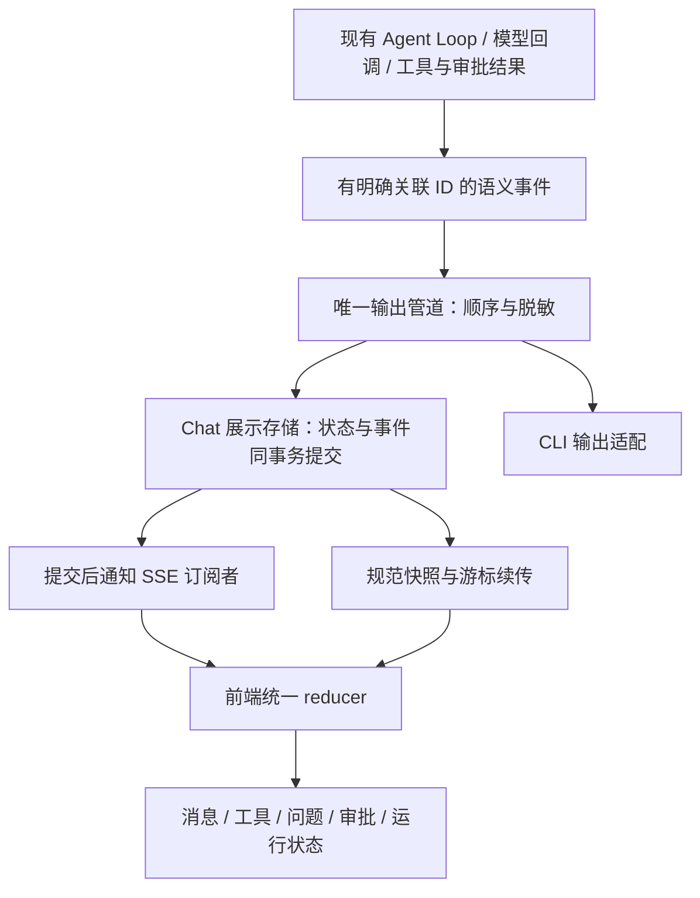

# Chat 流式输出与前端展示统一方案

- 版本：v1.3
- 日期：2026-11-16
- 状态：技术设计评审通过。主体代码已落地，2026-11-16 审查后补充重点修复；S1–S5 尚未完整验收，功能缺项与真实模型/弱网/MySQL/性能待验项见 §15。
- 决策：ADR-055。本文是本轮 Chat 输出、SSE、历史回放、交互展示的唯一设计入口。
- 范围：替换旧双路事件与双套时间线拼装；包含前端，不更换自研 Go Runtime。
- 基线：当前仓库代码与本地 kagent、HolmesGPT 实现核查；不以历史“测试通过”代表新方案已交付。

## 1. 决策与范围

保留现有 Go Agent Loop、LLM 适配、Tools、Policy、Approval、Executor、Session/Turn/Step、多集群绑定和单 Backend 部署。只重做输出链路及其必要的展示持久化契约。Turn 就是本轮运行，不再另建一套 Run/Task 调度系统。

本轮必须一起交付：正文真实增量、过程消息、工具与交互卡、正确的等待/终态、单一事件出口、同源历史和实时、断线补齐、错误与保存失败展示。不能只换卡片或增加事件后继续维护旧链路。

不纳入：ADK/LangGraph/A2A 运行依赖、第二 Loop、跨进程调度、专家 Agent、HA、任意执行点自动恢复、自动重放写操作。数据库结构和会话展示读取的必要调整属于本方案，不扩大到业务底座重建。

## 2. 旧设计废弃清单

“废弃整改”指不再作为后续实现依据；当前旧代码仍在运行，须按 §12 完成替换后才能标记整改完成。

| 旧设计 | 判断 | 新设计 |
| --- | --- | --- |
| Output 转换与 Tracer 各自生成对外事件，新旧 ChatEvent 并行广播 | 废弃 | 一条有序语义事件流；Tracer 只观察，不再产生另一份展示事件 |
| 正文整轮缓存，等确认没有工具后才展示 | 废弃 | 每次模型调用有独立消息，正文持续输出；结束时确定过程/最终用途 |
| 一个 turn+role 聚合所有正文，历史按 user 消息重新切 turn | 废弃 | 稳定 turn_id/message_id/part_id，实时与历史共用相同实体 |
| 所有 TurnUpdated 发 turn.completed | 废弃 | turn.status 明确表达非终态与终态 |
| 内存 512 条回放、客户端通道满静默丢弃 | 废弃为恢复保证 | 持久游标、缺口检测、快照重同步；内存仅作加速 |
| 重连清空已展示内容并重新猜分组 | 废弃 | 保留屏幕内容，按游标续传或原子安装规范快照 |
| 思考→工具→观察→报告为必经四步，缺思考标错误 | 废弃 | 真实过程时间线与单一运行状态，不造阶段、不因缺思考报错 |
| 先宣告成功，再保存会话；保存失败只走旧事件 | 废弃 | 事实提交后发布；失败有明确展示与恢复规则 |
| 提问卡另查接口并常态轮询，历史退化为工具结果 | 废弃展示机制 | 同源 Interaction 对象和事件；选择与审批授权仍分离 |

替代关系：ADR-032 的旧聚合/顺序/历史实现整体由 ADR-055 接管；保留“分片不是展示项、脱敏、权威全文校准”的原则。ADR-034 的工具结果字段语义保留，双路落地方式废弃。方案 14 §5、旧原型的 Chat 流程、方案 19 §4.4、用户决策文档的展示/恢复章节均被本文替代，其他业务设计不整体废弃。

## 3. 参考项目取舍

| 参考源 | 本轮借鉴 | 不搬入 |
| --- | --- | --- |
| kagent `go/adk/pkg/a2a/executor.go` | partial 与完整消息区分、工具内容关联、input-required 不等于 completed | ADK Runner、A2A Executor/TaskStore、CRD/Controller |
| kagent `ui/src/lib/messageHandlers.ts`、`chatSessionGuard.ts` | 增量归并、已答交互回看、动作前核对当前交互、历史/实时稳定 ID | React 页面及整套 metadata 兼容分支 |
| kagent `go/adk/pkg/tools/ask_user.go`、`AskUserDisplay.tsx` | 结构化问题、选择与自由输入、回答后继续；可适配纯转换函数与测试 | Google ToolConfirmation 依赖和将回答视为执行授权 |
| HolmesGPT `holmes/core/tool_calling_llm.py` | ai_message 过程说明、按工具调用 ID 发开始/结果、明确最终答案 | 主链路 `completion(stream=False)` 的非 token 输出策略 |
| HolmesGPT `holmes/utils/stream.py` | 一个格式化出口、统一错误、明确结束 | Python 依赖、整段 conversation_history 随终态反复下发 |

本地参考 kagent 已核查提交 `e3624635`；实施时把实际复用的固定完整提交、函数与适配写入 CREDITS，不用独立逐文件许可审查。跨语言或框架耦合片段按原逻辑适配，能照抄的直接照抄借鉴设计，不能独立复用的代码不为“照抄”引入框架。kagent 自身的 partial 清理、固定 TaskVersion 和历史转换分支不是我方必须继承的设计。

## 4. 目标链路与职责



- Agent 在事件产生时绑定关联 ID，不允许 service 消费时读取“当前 step”推测归属。
- 现有 `internal/sse` 承载唯一公共契约与编码；Agent 输出类型是其内层语义输入，不是第二套对外协议。service 负责安全处理与提交，不再重新解释消息用途。
- `internal/service` 负责单会话顺序、微批合并、提交与发布；`internal/store` 实现原子写和一致快照；`internal/sessionapi` 只鉴权、订阅、恢复、回传动作。
- Tracer/审计可订阅同一源的安全事实。原有 Turn/Step 记录由同一事实更新，不独立推导 UI 状态。审批/执行可靠审计仍走原安全门禁，不能被可失败的观察回调代替。
- CLI 直接复用应用服务的同一语义输出，可在本地内存/文件后端运行，不要求 HTTP、数据库或 SSE。终端交互方式保留。

## 5. 同一份可展示数据

### 5.1 对象与标识

| 对象 | 必要字段与语义 |
| --- | --- |
| Turn | 复用 turn_id；session_id、输入、状态、当前 activity、开始/结束时间、用量；绑定原 ClusterID |
| Message | message_id、turn_id、模型调用 invocation_id（本地每次调用生成）、role、purpose、status、parts |
| Part | part_id、message_id、type=text/reasoning、text、last_index；一段增量只属于一个 part |
| ToolCall | tool_call_id、turn_id、step_id、发起 message_id、工具名、脱敏参数、状态、结果、耗时 |
| Interaction | interaction_id、turn_id、关联 tool_call_id、kind、状态、版本、期限、公开载荷、脱敏答案 |
| Notice | notice_id、turn_id、severity、code、用户可读说明；覆盖降级、保存、模型和连接问题 |

稳定顺序使用服务端分配的 `item_order`，不按到达时间或数组下标排序。tool_call_id 必须区分重试调用；一次调用的开始、结果和历史共用同一个 ID。不同对象都不可用名称或相同命令文本去重。

`purpose` 为 pending/commentary/final。pending 表示本次模型调用的正文用途未定，UI 按普通助手发言展示，不能预先标成最终报告；它不是未审批写操作。模型调用结束后：有工具调用则 commentary；无工具且本轮正常结束则 final。每个模型调用有自己的消息，不把前一轮过程说明追加到后一轮结论。

### 5.2 唯一展示事实源

平台新增 Chat 展示实体与事件增量的存储能力，复用现有 SQLite/MySQL 和事务体系，不新增中间件。建议逻辑表为 `chat_items`（带 type 的版本化载荷）、`chat_events`（session_id+seq 唯一）、`chat_stream_heads`（会话水位/协议版本）；Turn 主记录复用现表。

一次提交事务完成：分配单调 seq、更新相关展示实体与 Turn 状态、追加安全事件、更新水位。只在提交成功后广播。最终全文不是终态后另存到一份权威 messages 中。

存储实现必须提供 `Commit(session_id, expected_head, mutations)`、`Snapshot(session_id)`、`ReadAfter(session_id, cursor, limit)` 三项能力。SQLite/MySQL 同时实现。单 Backend 内每会话一个有界顺序写入队列，事务检查 expected_head，冲突后按未提交命令 ID 重试。提交命令 ID 在事务内唯一登记，提交结果不明确时先查询登记结果，再决定是否重试，避免重复追加文本。模型和工具调用不随存储重试重复执行。

高频文本以追加块存储。`chat_items` 可承载独立 part 块行，键为 message_id/part_id/index，事务同步更新对象元数据、水位和事件。快照从已提交块组装正文，消息结束时一次性合并并回收块行。每次 delta 写入的数据量随本次增量增长，禁止每 100ms 重写累计全文 JSON。事件清理只能发生在对应文本已有独立可恢复存储之后。24 小时回放窗口同时受字节容量上限约束，清理推进明确的 replay_floor，较早游标通过快照恢复。

文本微批、工具结束、交互答复都进入该顺序入口。队列同时限制字节数与条目数，满时对模型读取施加可取消的背压，超过配置等待时限按输出失败收尾。不能同时承诺队列有界、生产者永不等待和所有数据永不丢失。控制事件沿同一顺序排队，预留收尾资源，禁止越过尚未提交的前序文本。工具调度前等待 tool.running 提交确认，交互等待者按 §8 在答复提交后唤醒。浏览器速度通过独立订阅层隔离。

`Session.Messages` 继续承担现有模型历史协议和上下文管理职责。统一语义提交入口负责同步其必要记录和展示记录，Web 历史读取规范展示对象。模型历史中的摘要、裁剪和工具协议字段保持既有语义，展示对象不承担重建模型上下文的职责。持久化时必须通过同一提交边界保存本轮所需模型记录与终态，终态提交失败按 §7.3 处理。tool_call_id、assistant tool_calls、tool result 等完整协议字段须保留，当前轮 ModelOnly 值仅存在于易失请求内存。

大工具结果继续用既有对象存储、摘要和授权读取，事件/快照共用同一个脱敏结果描述，不复制无限全文。已完成项可分页读；当前未完成 Turn 和待答交互必须在初始快照中，不被历史分页挤掉。

## 6. 公共事件契约 v2

复用 `/api/v1/sessions*` 命名空间。协议 v2 表示 Chat 流契约版本，不是平台 API 大版本。

```json
{
  "protocol_version": 2,
  "session_id": "s1",
  "turn_id": "t1",
  "seq": 128,
  "event_type": "message.delta",
  "timestamp": "2026-11-16T08:00:00Z",
  "data": {"message_id":"m2","part_id":"p2","revision":128,"index":3,"delta":"已确认"}
}
```

ID 字段按事件类型必填；不再要求无工具事件伪造 step_id。关联对象载荷带 revision（由更新 seq 赋值），快照包含相同 revision。流按 session_id 单序递增，服务重启不能重置；重复交付允许，乱序或缺口必须同步，不能“忽略重复”后继续使用残缺内容。

| 事件 | 含义 |
| --- | --- |
| `turn.status` | 完整 Turn 状态更新；状态是唯一运行依据 |
| `message.started` | 创建含 ID、顺序、用途和 part 描述的消息 |
| `message.delta` | 向指定 part 追加 index 连续的安全文本 |
| `message.completed` | 携带该消息完整安全对象，替换本消息暂存文本，确定用途 |
| `message.failed` | 本消息中断，携带安全部分正文与错误，不冒充完整结论 |
| `tool.updated` | 创建/更新单个 ToolCall，包含 started/running/succeeded/failed/denied/unknown 状态 |
| `interaction.updated` | 问题/审批/敏感读取交互的创建和状态变化，完整公开对象 |
| `notice.created` | 用户可见告警或错误，包含 code、severity、关联对象 |
| `usage.updated` | 本 Turn 的累计用量快照；覆盖而不是逐事件相加 |

以下为连接控制帧，不占持久业务 seq：`stream.snapshot`（规范快照+cursor）、`stream.reset_required`（续传范围失效）、`stream.fatal`（无法继续可靠输出，要求停止应用业务帧）。SSE `id:` 只用于持久事件，编码为 `<session_id>:<seq>`；心跳为注释，不推进游标。

旧 `session.completed/failed` 不再表示一轮结束；同一 Session 可继续对话。旧 `reason.*`、`observation.created`、`approval.*`、`question.*`、ChatEvent 对外广播由新对象事件替代，不留并行公共事件流。

## 7. 正文、工具、错误与终态时序

### 7.1 真正的流式输出

1. LLM 调用前创建 Message/Part，记录所属 Turn、invocation_id 和顺序。
2. content delta 经流式安全处理后进入同一管道；reasoning（仅提供方实际返回的可展示内容）为单独 part，缺失不是错误。不生成或索取隐藏思维链作为进度。
3. 安全文本按最长 100ms 或累计 4KiB 触发微批；每次提交一个连续 index 的 delta，避免每 token 一次数据库写。工具/交互/完成/失败事件前必须冲刷本消息已安全可释放的文本。
4. 模型返回工具调用：完整正文以 commentary 收敛，再生成带真实调用 ID 的工具卡；不把过程文字删除或替换成“最终报告”。不对未完成的工具参数 JSON 执行或向用户伪装为可执行命令。
5. 模型返回最终回答：完整 Message 提交后提交 Turn 终态，可在同一事务形成连续事件；最终全文仅替换同 message_id，不拼接两遍。

微批参数是首版工程基线，不代表任何环境都达到指标；数据库慢时不静默丢分片，也不回退旧链路，按 §9 处理。模型不支持 streaming 或 shim 使用非流式时，发送同结构的开始与完整消息，说明降级，不模拟逐字动画。

消息创建后，本次调用的工具请求/结果需在同一有序出口中位于其过程消息收敛之后。最终用量在 done 前提交，完成事件附消息完整 parts 与各 last_index；客户端只用 index 归并、不用字符串长度计算跨语言偏移。已经 completed/failed 的消息拒绝新 delta，重试模型调用必须创建新 invocation_id/message_id。

### 7.2 运行状态

状态复用 Turn 的 pending/running/waiting/done/failed/canceled，增加可区分的 `wait_reason`（question/approval/secret）和运行中 `activity`。中断异常使用 failed+`PROCESS_INTERRUPTED`，不为本轮另建调度状态机。

| 转换 | 对用户的含义 |
| --- | --- |
| pending → running | 已接收，开始处理 |
| running → waiting | 需要选择/审批，未完成 |
| waiting → running | 答案接受、必要核验后继续 |
| running → done | 正常结束，消息和状态已保存 |
| running/waiting → failed/canceled | 明确失败/取消；保留已保存过程 |

done 的含义是本轮处理结束，不是集群问题已修复；结果中应区分“已诊断”“未执行”“已执行并验证”等事实。工具失败不自动使整个 Turn 失败；当前 activity 只由事实产生，不根据最后出现的卡片推测。终态前关闭当前未完成消息，收束工具/交互状态，不允许终态后新 delta。取消或超时的工具执行结果未知时标 unknown，不伪造已回滚或已停止。

### 7.3 错误和保存失败

模型断流时保留已安全提交的部分正文，标 interrupted，不自动从头重试已输出的回答。无输出时可沿用现有受限降级重试；不能因此重放写操作。工具错误用 tool.updated，整轮错误用 notice+Turn 状态，不靠红色思考图标表示。

存储失败后停止生成和新的工具调度，尝试在有界时间保存失败状态。仍失败则发送非持久 `stream.fatal{code:PERSISTENCE_UNAVAILABLE,retryable:true}` 并关闭连接，UI 显示“输出未能可靠保存，请重新同步”。这条帧不携带尚未安全提交的正文。规范事件提交成功而网络发布失败时，由游标续传恢复。

中断判定由运行拥有者负责。单 Backend 启动时，在接收新运行前把上次进程遗留的 pending/running/waiting Turn 收束为 PROCESS_INTERRUPTED，并使待答交互失效。进程内存储故障恢复时，由运行注册表核对 worker 是否已退出，再提交失败状态。HTTP 重连只恢复读取，禁止仅凭数据库中的 running 状态把仍在执行的 Turn 判为失败。工具已发起且结果未确认时记录 unknown，后续迟到结果只补充对应工具事实，不复活终态 Turn。已执行动作通过原审计核对，避免重放。

## 8. 提问与审批展示统一，权限决策不合并

统一 Interaction 外壳，kind 为 question/approval/secret_read。公开状态为 pending/answered/approved/rejected/skipped/timed_out/canceled/invalidated，允许值按 kind 校验。问题的 answered 永远不等于审批 approved。

- 同一事务提交交互 pending 与 Turn waiting 后，前端展示对应卡片。提交成功才显示已回答/已审批，不靠本地点击提前更新。
- 复用现有具体问答/审批端点，补齐 interaction_id、turn_id、expected_revision、请求幂等键；前端只是同一个动作适配层，不另造通用授权 API。
- owner、当前身份/权限、集群绑定、凭据版本、审批期限与具体操作校验保持现有门禁；重复相同请求返回原结果，过期/冲突返回 409 并附安全同步提示，禁止二次执行。
- 问答和审批动作由当前运行的单一协调入口处理。该入口串行仲裁答复、超时与取消，校验身份、目标、期限及 expected_revision，成功后提交安全决策记录、Interaction、幂等结果与 Turn 转换，提交确认后才唤醒现有等待者。提交失败时保留可重试状态，禁止先向原 channel 发送批准结果。已提交但响应丢失时，同键返回原结果。
- 原审批门禁继续决定授权，Interaction 承载展示。需要文件审计时，沿用可靠审计要求，在唤醒与执行前完成审计成功确认。审计失败或提交后进程崩溃时收束为中断，已记录批准不代表操作已执行。重启后禁止通过重放批准记录自动唤醒旧操作。执行前仍完成既有权限与目标复核。
- 问题选项与自由输入遵循现行校验，选项基于可行方案；不把正文 A/B/C 自动解析成决策授权。模型应在真实分歧时调用 ask_user_question，最终正文不得用“选哪个”替代必要结构化提问。统一提示词并以真实模型用例验收；输出协议不能保证模型每次都识别业务分歧，不能宣传“永不漏问”。
- 等待期间断开浏览器不视为跳过，继续遵循已公布期限。浏览器重开从快照恢复待答卡；不再单独常态轮询 question 接口。等待时显示期限，区分连接重试与业务超时。
- 本轮保留进程内阻塞等待，不为了模仿 ADK 引入检查点执行框架。服务重启后旧待答交互失效为 invalidated，Turn 失败并说明中断，历史可看但不可提交；跨重启安全续跑仍归独立审批恢复设计。
- Secret 输入经原专用通道提交，不入通用答案载荷、事件、浏览器持久存储或历史；只展示目标/key、长度和指纹。秘密读取 always/auto 的决策语义不因 UI 统一改变。

## 9. 快照、续传、背压与连接

### 9.1 HTTP 契约

| 接口 | 新目标行为 |
| --- | --- |
| `POST /sessions/{id}/send-message` | 沿用请求，增加客户端请求幂等键；202 返回 session_id、turn_id、protocol_version；重复键不创建第二轮 |
| `GET /sessions/{id}/timeline` | 返回规范对象、当前 Turn/Interaction、cursor、protocol_version；历史按 Turn 分页 |
| `GET /sessions/{id}/stream?protocol=2&after=<cursor>` | fetch SSE；无 cursor 发送规范快照；有 cursor 先补齐后持续订阅 |
| 现有 question/approve/cancel | 保留业务边界，补交互版本/请求幂等；取消幂等，已终态返回当前状态 |

表中路径均位于 `/api/v1` 下。cursor 绑定会话并校验，不可越权；fetch 重连显式携带 after，也允许等价 Last-Event-ID，二者冲突返回 400。旧协议客户端在切换发布后返回 426+升级提示，不通过混发旧帧兼容。

请求幂等键使用 `Idempotency-Key`，限定当前操作者、session_id、动作种类与目标交互，服务端保存请求安全指纹及结果关联至少 24 小时。相同键和指纹返回原结果，键相同但内容变化返回 409。service 在同一事务内登记请求键、分配 turn_id 并创建 pending Turn，提交后调度 worker 并返回 202。现有 Agent 使用该 turn_id，避免再次创建 Turn。每会话最多一个 pending/running/waiting Turn，通过事务约束阻止双标签页同时提交，冲突返回 409 及当前 turn_id。Secret 答案不存入幂等载荷，指纹使用服务端带密钥摘要。该结果仅用于请求去重。

### 9.2 无竞态的快照和续传

1. 规范实体和 head 在一个短一致读事务获取，形成 cursor=S 的首屏快照，包含全部活动 Turn 与最近一页已结束 Turn。历史分页限定 completed_seq≤S 的不可变 Turn，按稳定的 completed_seq/turn_id 键集翻页。分页 token 携带 S、最后排序键、会话与数据代号，每页验证 token。首屏之后完成的 Turn 通过实时流进入页面，旧页不重复纳入。不跨 HTTP 请求保持数据库读事务，也不要求历史行支持任意水位版本查询。
2. 订阅通知先登记，再读取快照/日志；以数据库日志 `seq>S` 为事实读取，通知只唤醒查询，不能把“订阅通知没收到”当作“没有事件”。每个心跳周期也核对数据库 head，避免最后一条通知丢失后永远不收尾。从初始回放到实时的交接使用同一游标。
3. 前端原子安装快照，然后只接受 seq>S。重复 seq 忽略；seq 跳跃、part.index 不连续或缺少对象开始事件时暂停归并并重新同步，不向错误对象追加内容。
4. 日志保留范围内按游标补齐，超出范围发送 reset_required，客户端取新快照再续传。首版事件最长保留 24 小时，同时执行 §5.2 字节容量限制和 replay_floor 更新。实体保存周期沿用会话规则。日志可清理量不足以容纳新提交时显式失败，禁止删除当前实体或未收敛文本块腾出空间。
5. 所有新提交事件都必须先进入日志，内存通知可合并；慢客户端不阻塞执行主循环，也不静默丢业务事实。发送端写超时关闭连接，客户端从 last_applied_cursor 恢复。缓冲达到上限时 reset_required/断连；任何无法发送的控制帧也由关闭连接触发客户端恢复。

客户端游标高于当前 head 或属于另一协议代时要求重取快照。快照游标在原子安装成功后生效。已结束历史项冻结分页内容，迟到执行结果、导入或清理需要修改历史时提升会话数据代号，使旧分页 token 失效并触发重同步。单页不单独推进实时消费游标。

SSE 每 15 秒发送注释心跳；客户端 45 秒无帧进入重连，参数作为可测试的初始默认值。每次恢复成功重置退避；切换会话使用 generation+AbortController 防旧流污染；重连不立即清空已显示内容。401 进入登录处理，403/404 停止无效重试，426 要求刷新；网络故障按有上限的指数退避重连。持续失败提供手动重试。

### 9.3 能保证与不能保证的边界

提供：已提交事件至少一次交付、客户端幂等归并、日志内续传、日志外规范快照恢复、重启后已提交内容与中断状态可恢复。

不宣称：网络 exactly-once、每个模型 token 都原样保存、浏览器断线会取消执行、进程崩溃后任意执行点自动继续、写操作 exactly-once。发布与执行结果未知必须显式表达，不得借“恢复流”重新执行动作。

## 10. 前端设计

### 10.1 页面结构

保留现有 Vue、主题、布局、Markdown 安全渲染、结构化工具结果组件与滚动高度链。替换 MessageTimeline 中历史/实时两套组装；取消固定四阶段状态推测。

```text
用户：检查并修复 nginx
助手：先检查探针和 PVC 挂载。             ← 过程消息
工具：查询 Deployment / Pod              ← 稳定调用卡，展开查看证据
助手：缺少入口文件，需确认是否保留数据访问。
问题卡：保留 PVC 补齐内容 / 切换默认页面 / 暂不修改
运行状态：等待你选择                     ← 与连接状态分开
审批卡：选定方案的具体变更与风险
工具：执行结果、验证结果
助手：处理结果与仍未解决的问题。           ← 最终回答
```

顶部显示连接状态，Turn 内显示一个当前业务状态（检查中/生成回复/等待选择/等待审批/执行中/验证中/完成/失败/取消）；只有实际 activity 才显示相应措辞。没有验证动作不能显示“验证成功”，没有工具的普通回答不造工具/观察步骤。

### 10.2 单一归并与渲染

- `useChatStream` 只负责传输、心跳、重连与帧解析；新增纯 reducer/store 负责规范对象、seq 和 revision，组件不逐 token 全量重扫所有历史事件。
- 快照直接初始化同一个 store；实时事件更新同一对象，不维护 `hist:*` 与 live 两个 ID 空间。`message.completed` 替换同一消息，`tool.updated` 更新同一卡片。
- 多次模型调用显示多条助手过程发言，最终回答单独标识；reasoning part 可折叠查看，缺失不占位、不报错。工具和交互按 item_order 插入，不按工具名寻找“最近一个”。
- 问题与审批卡嵌入原发生位置，等待期间输入区附近可提供定位入口，不复制第二张拥有独立状态的卡。不用强制模态弹窗遮挡现场；需要提醒时使用待办提示与定位。
- 同一 store 驱动卡片、运行徽标、输入框和停止按钮。waiting 不显示“已完成”，不能发送依赖未答问题的新轮次；允许回答/拒绝/跳过和取消。是否排队新消息不在本轮扩展。
- 断线保留内容并提示重连；重连安装新快照后保留同 ID 的折叠偏好和滚动锚点。用户上滑不被强制拉回，仍显示“有新内容”。
- Markdown 增量可按动画帧节流，最终统一校准；未闭合代码块不导致 HTML/XSS 绕过。复制按钮取规范文本；工具失败、消息中断、任务失败分别展示。
- 长历史按 Turn 分页并增量更新；验收禁止每 token 重新构建全量时间线或把整个会话重复作为终态负载。

## 11. 安全与资源约束

所有输出在进入日志、展示实体、SSE 和 CLI 前使用同一安全管道。不能先存原文再在 GET 或 Vue 脱敏；原工具结果的结构化脱敏和授权读取继续保留。

增量安全不能对每个 chunk 单独正则替换后就宣称完成：必须覆盖跨分片的精确值和敏感格式。实现有状态流式脱敏器，保留未决尾部，已知精确敏感值按最长匹配长度保护；通用 key/配置格式的跨块模式用明确的状态识别。无法证明边界安全的块缓冲到可判定边界或整块完成，不能超阈值后直接释放原文。尾部和模型请求缓存有上限，超限进入安全非流式/明确错误，不新增无限缓冲。

读取 ModelOnly Secret 后，该模型请求的正文/reasoning 不做实时释放，沿用当前请求抑制通道；结束后只有精确脱敏的允许内容可成为最终公开消息，值不进入后续轮次。该安全降级必须在 UX 中说明为“敏感诊断处理中”，不能为了逐字效果削弱红线。

限制单消息、单事件、单会话大小并复用已有容量政策；工具大结果不放入高频事件。慢客户端限制与模型超时分离。身份、owner/管理员读取审计、多集群目标和权限撤销检查保持每个入口有效。日志/Events/资源字段仍为不可信数据，不影响流程授权。

## 12. 实施顺序、切换与旧数据

本轮是一个完整整改包，分阶段开发用于控制差异，不允许每阶段上线后永久并存两套协议。

| 阶段 | 交付物 | 出口 |
| --- | --- | --- |
| S1 契约与基线 | 事件/对象 Schema、reducer 输入样例、旧缺陷复现、固定参考源码映射 | 本文事件与用户场景都能用样例表达 |
| S2 单出口与存储 | 原位改 Agent Output/service；源头 ID、微批、安全处理、规范实体/日志事务、Turn 更新 | Tracer 不再另发 UI 事件；数据库失败无假成功 |
| S3 传输与恢复 | timeline、v2 SSE、游标、心跳、背压、幂等动作、交互状态 | 并发订阅/提交/重连无缺口，旧客户端明确拒绝 |
| S4 前端统一 | reducer/store、消息/工具/交互组件、等待/失败/取消、分页与滚动 | 历史和实时同 ID/同结构；移除旧拼装 |
| S5 联验与清理 | 故障注入、真实模型、旧数据转换、CLI 回归、删除双路适配及旧测试假设 | §13 全通过，更新实施状态后方可发布 |

实施触点：`internal/agent/{loop,message,trace,question}.go`、`internal/service/{chat,sse_tracer}.go`、`internal/sessionapi/{server,question}.go`、`internal/sse`、`internal/store` 迁移与实现；前端 `api/sse.ts`、`useChatStream.ts`、ChatView、MessageTimeline、TurnBlock、QuestionCard/ApprovalCard 和相关测试。具体文件拆分在 S1 核查决定，不把当前文件名当作必须保留的架构。

旧历史：迁移时一次性把可用 Turn/Step/messages 转成规范实体并持久化稳定 ID，不在浏览器继续保留旧解析器。能关联则复用原 ID；无法恢复的历史使用确定的 legacy ID，并标记 timing/status 来源缺失；不能补造耗时、审批同意或执行成功。无法关联的旧工具记录允许作为只读历史说明，不伪造新的真实执行。迁移幂等，保存映射和原始备份，测试重复运行不重复生成条目。

发布切换：先停接新运行并等待在途结束（或明确取消），备份并执行增量 schema/历史转换检查；后端与内嵌前端同版切换，清理旧协议出口与轮询。浏览器缓存旧 bundle 通过协议 426 刷新，不双发 v1/v2。开发阶段测试适配器可保留但不得作为生产第二条发布路径。

回退：代码回退须核验新 schema 是否与旧版本兼容；新记录不得被旧 messages 再次写回覆盖。保留旧资料只为审计与受控转换，不让两套事实源同时接收新写。无法安全回退时保持只读维护与备份恢复方案，不能用“打开旧链路”当作无损回退。

工程量在 S1 基于数据库原子能力、历史数据规模与安全流式处理实测重估；不沿用旧 P2.5/P2.6 的半天估算，也不把此次文档交付记成实现完成。数据库长期保留治理仍复用既有 P5，不另建完整事件平台。

## 13. 验收与性能基线

| 场景 | 必须验证的结果 |
| --- | --- |
| 普通长回答、无 reasoning | 回答结束前出现多次增量；无思考错误、无虚构工具阶段 |
| 三次模型调用、工具前说明 | 过程文字不消失；消息/工具顺序稳定；最终全文只替换最终消息 |
| 同名并发工具、重试、乱序完成 | 按 tool_call_id 更新；无错卡、重复卡、结果串联 |
| 工具失败后继续诊断 | 工具卡失败，任务可正常说明结果；不误标整轮失败 |
| 结构化选择→审批→执行→验证 | waiting 不被 completed 覆盖；选择不授予写权限；状态由同一 store 驱动 |
| 正文列举选项但不调用提问 | 真实模型评测捕获；提示词按必要决策整改，不自动解析正文授权 |
| 跳过、拒绝、超时、双击、多标签页 | 原子校验与幂等；不重复答复或执行；冲突后同步当前状态 |
| 模型首包前失败/中途断流/取消 | 有界降级；部分消息标中断；无重复写执行；不残留生成动画 |
| 每个消息/工具/交互边界刷新 | 恢复相同 ID、顺序、内容、状态、脱敏结果；仅动画可不同 |
| 丢通知、重复帧、缺帧、超过回放窗口 | 游标补齐或快照重置；不清空现场、不静默拼残缺文本 |
| 快照期间提交新事件、切换会话、慢客户端 | 无缺口、无旧会话污染、无无限缓冲；主循环不被浏览器拖死 |
| 数据库失败、提交后广播前崩溃、服务重启 | 无假成功；已提交内容可恢复；旧待答失效；未知写结果不重放 |
| Secret 值跨 chunk、敏感键跨 chunk、ModelOnly | 所有非模型出口零明文；断流与错误路径也覆盖；记录仅保留允许元数据 |
| 旧会话迁移、CLI、shim/禁用 streaming | 规范历史只读可看；命令行交互不退化；非流式无伪增量 |

首版性能基线（测试条件必须记录，非未测承诺）：在正常本地数据库与无代理缓冲环境，安全可释放模型增量至浏览器接收 p95 ≤300ms；100ms 微批不等待整次模型完成。使用固定延迟的假流模型保证首屏出现在模型结束前，不能用模型首 token 延迟掩盖应用缓存。

前端以至少 100 个历史 Turn、10,000 个文本分片压测归并；事件数量增长不导致每片全历史重建，内存受分页/保留限制。记录首段正文时间、更新延迟、快照耗时、缺口重同步次数、积压与存储错误；不采集 Secret/原始正文作为指标标签。

实施准出：`go test ./...`、`go vet ./...`、前端 lint/typecheck/测试/构建；新增 HTTP+store+reducer 契约与故障注入、浏览器弱网/刷新/滚动验收、真实模型多轮工具和提问审批联验。Go/组件测试通过不能替代端到端体验验收；构建后核对工作区，避免误提交 dist 占位变化。

## 14. 文档与状态回写

### v1.1 技术评审记录

2026-11-16 技术评审通过修订稿。整体采用统一语义出口、提交后发布、同源展示记录和前端 reducer。评审修正了运行中断判定、答复提交与唤醒顺序、分页可实现性、高频文本写放大及队列背压，并收紧模型历史职责和单会话运行准入。

S1/S2 必须用 SQLite/MySQL 故障注入验证提交确认、审批竞争、重连期间继续运行、慢数据库背压和分页边界。增加长回复存储增长检查，增量写入字节数应随总文本量近似线性增长。并发流容量和 300ms 基线以实测给出结论，设计通过不表示性能或发布验收完成。

本次仅完成新设计与旧条款废弃标记。ADR-055 的方向生效不代表其目标实现已交付；旧代码的问题保持“待整改”。新方案评审后按 S1–S5 实施，每阶段记录实际代码、测试、未验项目；整改完成才更新项目状态。PRD §8、API §9、旧前端/问答方案均指向本文，不再各自维护矛盾事件目录。

## 15. 实施记录（2026-11-16，v1.2）

### 15.1 实际交付

| 阶段 | 实际代码 | 自动化验证 |
| --- | --- | --- |
| S1 契约与基线 | `internal/sse/contract.go`（v2 对象/事件/控制帧/SSE id）、`internal/sse/serialize.go`；`internal/sse/contract_test.go`、`scenario_test.go` 覆盖普通回答、三次模型调用、工具失败、选择→审批→执行→验证、保存失败五个场景；`docs/CREDITS.md` 登记 kagent 固定提交与复用函数 | `go test ./internal/sse` 通过 |
| S2 单出口与存储 | Agent 源头 ID 语义事件：`internal/agent/flow.go`、`loop.go`、`question.go`（真实 content/reasoning 增量、每模型调用独立消息、稳定 tool_call_id/interaction_id、工具卡 started→running→终态、审批/提问/敏感读取统一 Interaction）；`internal/service/chatflow.go`（每会话有界顺序写者、100ms/4KiB 微批、stateful 流式脱敏、提交后广播、输出失败 fatal + 取消运行）；`internal/service/redactstream.go`；`internal/store/chat.go` 与迁移 v13（`chat_items/chat_chunks/chat_events/chat_stream_heads/chat_commits/chat_legacy_migrations`，Commit/Snapshot/ReadAfter/Head，命令 ID 幂等、head 冲突重试、终态与模型历史同事务） | `internal/service`（含跨分片脱敏、运行中快照、单出口顺序）、`internal/store`（幂等/冲突/续传下限/块回收）用例通过 |
| S3 传输与恢复 | `internal/sessionapi/server.go`：`timeline`、`stream?protocol=2&after=`、`Last-Event-ID`、快照/reset_required/fatal、15s 心跳、慢客户端断连；`Idempotency-Key`（进程内 24h）；问题/审批复用原端点并绑定 interaction_id；旧协议 426 | `internal/sessionapi` 快照/补齐/426/fatal 用例；`tests/platform` 越权与真实装配回归通过 |
| S4 前端统一 | `web/src/api/chat.ts`（v2 类型与帧解析）、`web/src/chat/store.ts`（纯 reducer：同 ID upsert、重复 seq 忽略、缺口重同步、wait_reason/activity）、`useChatStream.ts`（游标续传、断线保留内容、401/403/404/426 停止重试）、`MessageTimeline.vue`/`TurnBlock.vue`/`QuestionInteraction.vue` 改由规范对象驱动；删除轮询问题卡与四阶段步进器 | `web` 35 文件 235 用例、typecheck、lint、build 通过 |
| S5 联验与清理 | 旧会话按需幂等迁移（`internal/service/chatmigrate.go`，确定性 legacy ID、缺失来源标注）、删除旧 `internal/sse/legacy.go` 与 Tracer 展示广播、移除前端 legacy 映射与 question 轮询；文档/CREDITS 回写 | `go test ./...`、`go vet ./...` 通过；前端门禁通过 |

### 15.2 关键行为约定（实现口径）

- 每条 SSE 持久事件由存储事务分配 `seq`，`id: <session>:<seq>`；控制帧不带 id、不推进游标；重复投递由客户端按 seq 幂等归并，缺口触发按游标重同步。
- Agent 的 `message.delta` 是真实模型增量（native 流式）；非流式/shim 只发开始与完整消息，不模拟逐字动画；敏感值在场时抑制实时释放，完成消息只用脱敏全文。
- 工具卡失败不使整轮失败；审批/问题/敏感读取共用 Interaction 外壳，但回答仍不授予写权限。
- 终态 `turn.status` 与模型历史在一个事务提交，提交成功后才广播；持久化失败发送 `stream.fatal{PERSISTENCE_UNAVAILABLE}` 并取消运行。
- 旧 `ChatEvent` 只保留为 CLI 内部事件，不再作为公共 SSE 帧广播。

### 15.3 未验项目（不得视为通过）

1. 真实模型多轮工具、真实分歧触发 `ask_user_question`、选择→审批→执行→验证的端到端体验未在真实集群/真实模型上验收。
2. 浏览器弱网、刷新、多标签页、慢客户端断连恢复的现场验收未执行；仅完成单元/组件级回归。
3. MySQL 集成用例未运行（需 `AEGISOPS_TEST_MYSQL_DSN`）；迁移 v13 与 `FOR UPDATE` 水位锁仅按 SQLite 实测。
4. 首版性能基线（增量到浏览器 p95 ≤300ms、100 历史 Turn/10,000 分片压测）未测量，不宣称达标。
5. `timeline` 目前只支持 `turn_limit`，尚未实现文档 §9.2 的稳定分页 token/`before` 键集翻页。
6. 请求幂等键保存在进程内（24h TTL），重启后不再去重，持久化尚未实现。审批页面已携带 expectedRevision，服务端在当前 pending 对象上校验并以 head CAS 提交，成功后才唤醒等待者。旧调用省略 revision 时仍按 interaction_id 和 pending 状态校验。
7. 回放日志按 24h + 条目数上限清理；字节容量上限与 `replay_floor` 的独立治理尚未实现。
8. Secret ModelOnly 通道在 v2 全链路（跨 chunk、断流、错误路径）的零明文回归未做专项真实模型演练。
9. 前端 bundle 通过 426 强制刷新升级、旧 bundle 缓存行为的实测未做。
10. 旧会话迁移只覆盖 `session.Messages` + `turns` 的可关联部分；工具结构化 `data` 与耗时缺失按“来源缺失”处理，未与真实现场历史做抽样核对。

### 15.4 审查后的重点修复（2026-11-16）

- Agent 不再提前发布或独立保存终态，service 的 Finish 将 Turn 终态与模型历史原子提交后统一发布，新增最终保存失败无 done 的故障注入回归。
- 流式脱敏保护单字符关键字前缀，敏感字段保留到行边界，私钥保留到块结束。新增 JSON/Authorization/配置键在每个字节切分位置的回归，完成消息保留 reasoning 正文。
- 注释心跳与实际接收活动续期 watchdog，45 秒无活动会建立替换连接，旧 generation 的收尾不清除新连接计时器。消息缺口使用规范快照重同步。
- SSE 转发 fatal 控制帧后关闭连接。失败写者退出后可重建，Agent 退出后尝试保存中断状态。单 Backend 启动时先收束遗留运行、待答与未知工具状态，再接受新 Chat；恢复失败时拒绝 Chat 和快照。
- 审批审计失败保留 ticket 供重试。问题答复在 Pending 锁内先校验和提交，再释放到等待通道；审批答复先提交公开状态再唤醒，Secret 内容仅走原内存通道。HTTP 审批串行仲裁，原权限门禁继续执行。
- 这些修复不代表 §15.3 的功能缺项或现场验收已经完成。真机重点验证长于 45 秒的会话、刷新/断网恢复、选择与审批、服务重启、完成前后的历史一致性。
- 本轮验证通过 `go test ./...`、`go vet ./...`、前端 typecheck/lint、35 文件 237 用例和生产构建。新增故障回归覆盖终态保存失败、审批版本/重复答复、审计失败重试、问答提交失败不唤醒、重启待答失效、fatal 到浏览器、45 秒 watchdog 与每个字节边界的敏感字段切分。MySQL 与真实集群验收仍待执行。
