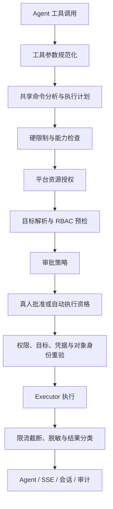

# Agent Exec 与 Shell 执行能力设计方案

版本：v1.0

日期：2026-11-17

状态：已评审；代码与本地验证完成，真机验收待执行

适用范围：AegisOps Kubernetes Agent 的命令解析、Pod 执行、授权审批、执行隔离及结果处理。

## 1. 设计目标

建立统一、可解释、可验证的 Agent 执行策略，在保持多租户授权、集群目标绑定和敏感数据保护的基础上，提供常用 Kubernetes 深度诊断能力。

本方案实现以下目标：

1. 通过结构化 `exec_pod` 工具执行业务容器内的非交互诊断命令。
2. 统一结构化 exec 与 `kubectl exec` 的目标解析、权限校验、诊断规则和审批行为。
3. 保持可证明只读的 kubectl 命令组合自动执行，避免因 Shell 表面语法要求额外授权。
4. 将资源授权、命令支持范围、操作风险、人工审批和执行环境能力分开判断。
5. 所有执行入口遵循同一安全边界，审批不可绕过授权、目标隔离或敏感数据策略。
6. 保持现有 Agent Runtime 和 client-go 架构，为后续宿主机执行和独立脚本执行保留明确扩展边界。

## 2. 范围与规范关系

### 2.1 本期范围

- 新增 `exec_pod` 工具及对应 Executor 执行能力。
- 扩展常用容器诊断命令与参数支持。
- 收敛 `kubectl exec` 到与结构化工具相同的执行策略。
- 统一命令分析结果及授权、审批、执行之间的传递契约。
- 补齐普通工具审批不可用时的拒绝路径。
- 对齐 Kubernetes 只读命令在解析层、授权层和执行层的支持范围。
- 完善错误分类、审批展示、输出处理、审计及验证。

### 2.2 本期不交付

- Pod exec 自动批准、批量批准和会话免审。
- 任意容器文件内容读取、任意容器内解释器或脚本执行。
- 通用服务端 Shell、Python 或用户脚本执行环境。
- 临时诊断 Pod、节点侧 Agent、SSH 宿主机执行工具。
- 每任务独立 Sandbox、Sandbox 调度系统或 Agent Runtime 服务拆分。

上述扩展不影响本期接口的完整性，不为其增加空实现或对用户暴露不可用开关。

### 2.3 规范优先级

本期继续遵守 `AGENTS.md`：所有非交互 Pod exec 均须逐次真人批准；`--skip-permissions`、`require_approval=false`、会话授权缓存和批量授权均不能免除此次批准。

Secret 遵循 2026-11-16 生效规则：namespace read 授权包含范围内 Secret 读取资格，但每次具体 Secret/key 读取仍须明确询问用户，并在同意后重验权限。明文只通过既有专用通道处理。

本方案延续方案 22 的 TargetBound、多集群与凭据版本校验，以及方案 24 的只读命令组合。与历史文档中按 Shell 符号决定权限的描述不一致时，以本方案定义的完整命令语义判断为准；不改变现行 exec 与 Secret 强制确认规则。

## 3. 能力模型

### 3.1 执行位置与执行方式

执行位置描述程序实际运行的边界，执行方式描述如何调用程序，两者分别记录。

| 能力 | 实际执行位置 | 执行方式 | 本期处理 |
|---|---|---|---|
| Kubernetes 结构化读取与变更 | Kubernetes API | client-go | 保留 |
| 单条 kubectl | 平台侧 kubectl 客户端 | 固定二进制 argv | 保留并统一策略 |
| kubectl 查询与文本过滤组合 | 平台侧受控子进程 | 受控 argv 执行图 | 保留 |
| 业务 Pod 内诊断 | 目标 Pod 的指定容器 | Kubernetes exec，远端 argv | 新增结构化入口 |
| 平台侧真实 Bash | 平台侧操作系统 | Shell 解释器 | 平台 TargetBound 模式不开放 |

`kubectl exec ... -- ls /app` 在平台侧启动 kubectl，但诊断程序在业务容器内运行。平台侧 argv 进程隔离不能限制该远端程序在业务容器中的权限。

### 3.2 决策模型

复用既有 `AUTO`、`REQUIRE_APPROVAL`、`DENY` 决策，不新增并行的审批体系。

| 条件 | 决策 | 说明 |
|---|---|---|
| 已授权、目标明确、属于可证明只读 Kubernetes 查询或受控组合 | AUTO | 每个调用分别授权 |
| 已授权、目标明确、属于支持的 Pod 诊断规则 | REQUIRE_APPROVAL | 每次真人批准 |
| 已授权、目标明确、属于既有允许的 Kubernetes 变更 | 沿用既有审批策略 | 自动化例外仅限原有普通变更 |
| 缺少资源授权、明确 RBAC 拒绝、违反硬限制或目标隔离 | DENY | 不发起审批 |
| 命令语义不受支持，无法构造可靠执行计划 | DENY | 返回能力不支持及替代方式 |
| 需要审批但没有可用确认通道 | DENY | 不执行、不自动降级 |

不在诊断规则内，表示尚未满足支持条件；不等于用户越权。只有在目标、动作、数据访问和执行方式均可确定时，命令才具备进入审批的资格。

### 3.3 风险与敏感性

风险等级用于描述操作影响；数据敏感性用于描述读取内容。两者不能相互替代，也不能单独决定授权。

- `IsReadOnly` 继续表示是否属于可证明只读的自动执行集合。本期 `exec_pod` 始终返回 false。
- `exec_pod` 的基础执行能力维持 HIGH，审批原因补充具体诊断行为与剩余风险。
- 诊断命令不宣称“绝对只读”：目标容器中的同名程序可能被替换，其行为不能仅凭名称证明。
- 不因风险显示为 LOW/MEDIUM 就免除强制真人批准。

## 4. 总体架构与处理流程



任一步骤拒绝均停止当前调用，返回结构化原因。单个调用失败不终止整个 Agent Loop。

### 4.1 模块职责

| 模块 | 职责 |
|---|---|
| `internal/cmdplan` | AST/argv 分析、受支持命令语义、目标描述和受控执行图；不查询用户授权 |
| `internal/tools` | 工具 Schema、输入校验、上下文绑定、执行计划适配、结果封装 |
| `internal/authz` | 用户在集群、namespace、资源与动作上的资格判断 |
| `internal/approval` | 风险、硬门禁和是否需要确认的确定性决策 |
| `internal/agent` | 挂起与恢复审批、执行前重验、错误反馈和工具调度 |
| `internal/executor` | kubectl、受控子进程、Pod exec 和既有 Kubernetes 变更的唯一执行边界 |
| `internal/cluster` / service 装配层 | 会话集群、目标客户端、凭据版本和运行时绑定 |
| Web UI / SSE / Audit | 复用现有交互和结果契约，展示已脱敏信息 |

不将平台授权或 Kubernetes 凭据解析引入 `cmdplan`；不在工具层直接启动进程或建立远端 exec 流。

### 4.2 共享分析与执行计划

扩展既有命令分析结果，使三个入口——`exec_pod`、单条 kubectl、受控命令组合——能够表达相同语义。

执行计划至少包含：

| 字段 | 含义 |
|---|---|
| planVersion / policyVersion | 计划结构版本及诊断策略版本 |
| sourceTool | 原始工具入口 |
| executionLocation / executionMode | 执行位置与 argv、受控执行图等方式 |
| boundClusterID / credentialVersion | 服务端绑定目标及凭据版本 |
| targets | 每个调用的 namespace、GVR、名称、动作；Pod 执行额外记录 Pod UID 与容器身份 |
| argv / program | 精确远端 argv 或受控执行图 |
| diagnosticRule | 匹配的诊断规则及规则版本 |
| risk / sensitivity / requireHuman | 风险、数据敏感性与强制确认要求 |
| timeout / maxOutputBytes | 服务端裁剪后的执行限制 |
| fingerprint | 对规范化执行语义计算的摘要 |

请求文本是输入，执行计划是校验后的内部值。计划由服务端构造，模型不得提交 `approved`、集群凭据、执行身份或策略覆盖字段。

fingerprint 覆盖集群、namespace、Pod UID、容器、argv、策略版本及执行限制，不包含明文凭据。计划变化后原批准失效。执行前允许重新分析输入进行一致性校验，不允许重新解析成不同语义后沿用旧批准。

需要真人批准的执行计划必须同时具备服务端生成的单次执行许可，许可绑定本调用的身份、目标与 fingerprint。工具不能仅凭客户端参数或上下文中的任意布尔值认定已批准。Agent 消费真实审批结果后通过受信内部调用链向 Executor 传递许可；Executor 在建立 exec 流之前验证许可存在、未失效且与实际请求一致。直接调用工具 Execute、CLI 路径或其他内部入口也不能绕过该条件。许可仅在当前运行时维护，复用既有审批事件记录，不新增通用令牌服务或持久化授权表。

不建立新的通用插件框架；上述字段整合进现有分析和执行请求类型，按当前包依赖保持单向引用。

## 5. exec_pod 工具

### 5.1 输入契约

工具名：`exec_pod`。

```json
{
  "namespace": "test-complex",
  "pod": "app-backend-b664b9766-45c2z",
  "container": "backend",
  "argv": ["ls", "-l", "/usr/share/nginx/html"],
  "timeout_seconds": 15
}
```

| 参数 | 类型 | 必填 | 约束 |
|---|---|---|---|
| namespace | string | 是 | 明确名称；不支持 `*` 和跨 namespace 选择器 |
| pod | string | 是 | 单个 Pod 名称；不支持 Deployment、标签选择器或通配符 |
| container | string | 条件必填 | 单个运行中普通容器可推导；多个普通容器时必须指定 |
| argv | string[] | 是 | 非空，首项为支持的诊断程序名；不接受完整 Shell 字符串 |
| timeout_seconds | integer | 否 | 默认 15 秒，范围 1—30 秒；同时受任务剩余时限约束 |

服务端拒绝未知参数、空字节、控制字符、过长参数及超量 argv。规范化请求总大小上限 8 KiB，argv 最多 64 项，单项最多 2 KiB；超限返回 INVALID_ARGUMENT。

工具不提供 cluster、context、server、kubeconfig、token、用户身份、环境变量、工作目录、stdin、TTY 或提权参数。

### 5.2 目标解析

1. 从当前会话取得已绑定集群，不允许模型选择执行集群。
2. 先校验 namespace 范围与 exec 动作资格，再使用绑定客户端读取指定 Pod。
3. 确定 Pod UID、容器名称、containerID、重启计数和当前运行状态。
4. 多容器未指定、容器未运行、Pod 正在删除时不执行；分别返回明确错误。
5. 本期仅支持运行中的普通业务容器，不支持 init container、ephemeral container 或通过工作负载自动选择 Pod。
6. 对 privileged、hostPID、hostIPC、hostNetwork 或 hostPath 挂载的 Pod，拒绝本期通用诊断入口，返回 `POLICY_DENIED/POD_ISOLATION_UNSUPPORTED`。

最后一项是执行环境门禁，不是用户授权结论；管理员身份和人工批准均不覆盖该门禁。已有结构化 Kubernetes API 诊断仍可使用。

### 5.3 诊断规则目录

规则使用明确程序名、参数语法及数值边界，不使用命令前缀或自由正则作为唯一校验。

| 程序 | 本期允许形式 | 限制 |
|---|---|---|
| hostname | 无参数 | 不允许修改主机名的参数 |
| uptime | 无参数 | 不接受扩展参数 |
| id | 无参数 | 不查询指定用户；结果按普通诊断数据处理 |
| pwd | 无参数 | 仅目录路径，不自动关联文件读取 |
| ls | `[-a] [-l] [-h] [--] PATH` | 必须一个绝对路径；不支持递归、通配符和多目标 |
| stat | `[-L] [--] PATH` | 单一绝对路径；不支持格式字符串；`-L` 时实际目标必须通过路径规则 |
| df | `[-h 或 -k] [--] [PATH]` | 最多一个路径；不接受任意其他参数 |
| du | `-s [-h 或 -k] [--] PATH` | 单路径；受 15 秒默认超时约束；不递归输出目录列表 |
| ps | 无参数，或 `-e -o pid,ppid,comm` | 无参数由服务端规范化为有限字段形式；不允许 args、command、环境变量或任意格式 |
| ss | `-s`、`-lnt`、`-lnu` | 不允许 kill、process、过滤表达式和其他参数 |
| netstat | `-lnt`、`-lnu` | 不允许进程参数、扩展过滤和其他参数 |

规则不承诺所有业务镜像都具备对应程序与选项。缺少程序或 BusyBox/procps 参数不兼容时返回明确结果，Agent 可选择另一个已支持规则，不自动回退 `sh -c`、安装软件或下载二进制。

不允许绝对路径程序、相对路径程序、BusyBox 多调用包装器、`env`、`printenv`、`cat`、`find`、`curl`、`wget`、`awk`、`sed`、`xargs`、`sh/bash`、Python/Perl/Node、包管理器及任意脚本。本期未知程序返回 `UNSUPPORTED/EXEC_COMMAND_UNSUPPORTED`，不伪装为权限不足。

诊断目录可以扩展，但每次扩展必须同时提交参数语义、数据风险、资源开销与对应测试；不向普通用户开放任意命令免审配置。

### 5.4 路径规则

目录与属性查询要求：

- 使用绝对路径，规范化重复分隔符和 `.`；拒绝 `..` 路径分量、控制字符与通配符。
- 拒绝凭据目录及伪文件系统：`/var/run/secrets`、`/run/secrets`、`/var/secrets`、`/etc/secrets`、`/vault/secrets`、`/proc`、`/sys`、`/dev` 及其子目录。
- 结合 Pod spec 拒绝 Secret volume、projected Secret、serviceAccountToken、CSI Secret 类挂载及其 subPath 目标。不能确定挂载敏感性时不进入路径诊断。
- 拒绝 `.kube`、`.ssh`、`.aws`、云凭据目录及明确的凭据文件路径。
- `ls` 不提供跟随链接的参数；可能遍历链接的路径操作必须先在容器内解析实际路径，再对实际路径复核规则。解析失败则拒绝，不回退到仅检查字面路径。
- 内部路径解析作为同一次批准计划的一部分，只用于校验目标，不能读取内容或扩大目录范围。

路径检查不被描述为恶意容器下的原子文件系统隔离：远端程序及文件系统均不由平台完全控制。本期能力限于人工批准的目录和属性诊断，不提供文件内容读取，因此不以路径检查替代 Secret 内容读取契约。

## 6. 授权与 Kubernetes RBAC

### 6.1 平台授权

`exec_pod` 与兼容 `kubectl exec` 均使用现有 `ActionExec`。

- 资源目标为绑定集群、明确 namespace、具体 Pod。
- 沿用现有 exec 所需的 read、operate、exec 权限依赖，不修改现有授权数据模型。
- 不要求 `ActionShell`、集群级 destroy 或全 namespace 授权。
- 纯报告权限不产生 exec 或 namespace 授权。
- Admin 仍受诊断规则、强制审批、目标隔离和 Kubernetes RBAC 约束。

平台授权失败时立即返回，不读取诊断内容、不发起审批。Pod 元数据查询仅发生在已授权 namespace 内。

### 6.2 RBAC 预检与最终校验

审批前对实际绑定执行身份检查：

- `get pods`：读取当前 Pod 与容器身份。
- `create pods/exec`：建立 exec 连接；若选用传输实际要求其他动词，应按该传输补充检查。

预检明确拒绝时返回 RBAC_DENIED。预检网络错误或审查接口不可用时标记 `unknown`，不得显示已通过；允许后续在真人批准后由真实 API 请求作最终授权判断。预检未知不改变平台权限与强制确认要求。

实际 exec 请求必须由绑定客户端使用当前凭据发起，Kubernetes API 的 RBAC 判定始终是最终边界。取消本地命令不等于远端程序必然已结束，相关处理见第 10 节。

### 6.3 审批后重验

批准后、建立 exec 流前重新检查：

1. 用户仍有效，平台授权仍成立。
2. 会话绑定集群仍有效，凭据版本未变化。
3. Pod UID、容器名称、containerID 与批准计划一致，容器仍运行。
4. Pod 安全属性、敏感挂载和路径条件仍符合规则。
5. argv、策略版本、超时与输出上限未变化。

Pod 被重建、容器重启、凭据轮换或策略变化时使原计划失效，停止当前调用。Agent 必须取得新计划并重新批准，不自动追随同名对象。

Kubernetes exec 接口不提供与上述所有状态检查合并的原子事务，因此仍存在检查与连接之间的短暂竞态。不得宣称 Pod UID 重验等同于原子 UID 前置条件。

## 7. 审批契约

### 7.1 强制逐次确认

`exec_pod` 实现既有 MandatoryHumanApproval 能力，始终返回 true。兼容入口的 exec 具有相同要求。

Agent 必须在任何工具执行前完成以下统一检查：当决策为 REQUIRE_APPROVAL，且不存在本调用的有效批准时，确认通道不可用即返回 `TOOL_UNAVAILABLE/APPROVER_UNAVAILABLE`。不能记录为 ApprovalSkipped 后继续。

exec 不进入批量审批、不产生会话 Grant，不展示“本次会话不再询问”。旧会话 Approved 记录不能满足本次 exec 确认。用户拒绝后按现有拒绝计数机制收敛，不得换成 kubectl 入口重复索取同一授权。

### 7.2 审批展示

审批卡至少包含：

- 集群显示名、namespace、Pod 和容器。
- 规范化后的实际 argv，按安全转义展示，仅供阅读。
- 诊断目的、基础风险、数据类型及规则说明。
- 平台授权、RBAC 预检、目标绑定和策略检查结果。
- 超时时间、输出上限。
- “确认执行”和“拒绝”两个选项。

批准绑定 toolCallID、interactionID 与 fingerprint，单次消费。不能接受模型文本中的“用户已同意”，不能用上一轮对话中的笼统意图替代审批结果。

### 7.3 执行终态

批准不代表执行成功。交互状态与执行状态分别维护；用户应能区分已拒绝、批准后过期、执行失败、执行超时和执行成功。

## 8. kubectl 与命令组合策略

### 8.1 kubectl exec 兼容入口

`kubectl exec POD -n NS [-c CONTAINER] -- PROGRAM ARGS...` 解析为与 `exec_pod` 相同的请求。

- 要求明确 `--` 和远端程序。
- 全局参数按 kubectl 语法识别，不依赖固定 `argv[1]` 位置；重复或冲突 namespace/container 参数拒绝。
- `--` 之后全部作为远端 argv 数据处理，不允许被再次解释为本地 Shell。
- 拒绝 `-i/-t/--stdin/--tty`、工作负载目标、标签选择器及隐式默认 namespace。
- `kubectl exec … -- sh -c …` 返回策略拒绝，不转为服务端 Bash。
- 兼容入口与结构化入口共享规则、审批指纹和错误原因，不允许入口切换扩大能力。

### 8.2 可证明只读的命令组合

延续现有 AST 分析与受控执行图：支持符合规则的 `|`、`;`、换行、`&&` 和 `||`。所有分支均须静态校验，每条 Kubernetes 查询单独授权。

过滤器仅处理前一阶段 stdin，按既有验证参数表支持 grep、head、tail、sort、uniq、wc、cut、tr 和受限 jq。拒绝额外文件、解释器、环境赋值、动态展开、替换、重定向、后台任务和其他不受支持构造。

已证明安全的组合不要求 ActionShell，不依赖 `platform.exec.shell_enabled`，不传给 Bash 重新解释。保留条件执行与退出码语义；查询失败不得被后续过滤成功覆盖，grep 无匹配返回无匹配结果。

本期不允许将 Pod exec 混入自动执行组合。需要“exec 后过滤”时，先执行并批准单次 exec，随后由模型或既有安全结果处理完成分析，不引入新的本地文件或 Shell 通道。

### 8.3 只读能力一致性

| 命令类型 | 授权映射 |
|---|---|
| get/describe/top/explain 等资源查询 | 按规范化资源与 scope 校验 read；不支持或隐含额外读取的形式拒绝 |
| logs | 具体 Pod 的 read/logs |
| events | 明确 namespace 或经授权的集群范围 |
| rollout history/status | 对应 Deployment/StatefulSet/DaemonSet 的 read；其内部所需关联资源读取也受授权限制 |
| version | 本地客户端信息无需资源授权；连接 API Server 的版本读取使用绑定集群的元信息读取资格 |
| api-resources | 绑定集群的 API discovery 读取资格，不扩大任何实际资源读取权限 |
| auth can-i | 新增受限语法，只查询当前执行身份对明确资源、动作和 namespace 的资格；不支持 impersonation 或 `--list` |
| CRD 实例查询 | 使用绑定集群 discovery/RESTMapper 得到 GVR 和 scope，随后检查平台资源授权与真实 RBAC |

集群元信息读取资格由“用户对该集群至少持有一条有效资源授权”推导；纯报告权限不满足该条件。只开放版本与 discovery，不继承为 node、集群资源或 namespace 通配读取。

动态发现只能确定资源身份和 scope，不能产生授权。现有 ResourceProfile 未包含的 CRD 默认返回 UNSUPPORTED/RESOURCE_PROFILE_UNSUPPORTED；需通过单独评审的资源配置变更加入支持，不能仅凭“namespace 已授权”放行任意新 CRD。discovery 按集群及凭据版本缓存，缓存失效不回退静态猜测。

### 8.4 真实 Shell

平台 TargetBound 模式继续拒绝不能编译为受控执行计划的真实 Shell，即使用户批准或 `shell_enabled=true` 也不执行。

`shell_enabled` 只描述解释器通道配置，不授予资源权限，不覆盖 TargetBound，也不控制已证明安全的受控组合。

本地 CLI 的既有真实 Shell 兼容路径保持交互式真人审批、硬限制与 deny_ops 约束。本方案不将其开放为平台多租户能力，不降低其既有权限要求。该路径也必须应用统一的审批缺失拒绝逻辑。

可明确转换的 manifest heredoc 优先转为结构化 `create_resource` 等既有入口，完成完整对象校验与审批；不通过开启 Bash 绕过 TargetBound。

## 9. 敏感数据保护

Pod exec 不是 Secret 读取通道，不提供以下能力：

- 环境变量、进程完整命令行、服务账号 token 和凭据文件读取。
- 任意文件内容读取或通过解释器、编码、压缩程序间接输出文件。
- 读取 Secret 挂载、投射卷或宿主机文件。
- 使用远端 kubectl、curl 等访问 API 或将内容发送到其他目标。

需要具体 Kubernetes Secret/key 时使用 `get_secret_value`；逐次明确确认、权限重验、ModelOnly、非模型出口脱敏及独立 secret/reveal 规则均保持不变。

目录名、进程名和端点信息也可能包含敏感数据。所有工具结果复用现有通用脱敏和已知值精确脱敏；截断边界不得破坏脱敏匹配。审计不记录原始 stdout/stderr。

通用脱敏不能保证识别任意未知密码，因此不将其作为开放任意文件读取或任意解释器的依据。容器输出始终作为不可信数据进入模型，不能驱动新的授权或执行决策。

## 10. Executor 与资源控制

### 10.1 Pod exec 实现

在 `internal/executor` 增加 `ExecPod(ctx, request)` 能力，使用绑定 RESTConfig、client-go remotecommand 和明确 argv 建立非交互流；优先复用项目锁定版本已支持的传输能力，不以新增功能为由强制升级依赖。

stdin、TTY 固定为 false，stdout/stderr 分别捕获。工具层不接触凭据明文、不拼接 Shell、不直接执行 client-go exec。

兼容 `kubectl exec` 规范化后也进入此能力，避免使用两套远端执行实现。

### 10.2 默认限制

| 项目 | 本期规则 |
|---|---|
| 单次 exec 超时 | 默认 15 秒，最大 30 秒 |
| 任务取消 | 立即取消流与本地等待 |
| stdout + stderr 总捕获量 | 共享 64 KiB 上限；超限丢弃后续数据，返回 truncated |
| 同会话 exec 并发 | 1；不并行启动多条 exec |
| 平台侧 exec 并发 | 默认全实例 8、单用户 2；超额快速返回 EXECUTION_BUSY，不无限排队 |
| 自动重试 | 无；失败后由 Agent 根据错误决定下一步 |

执行期限从批准后开始，审批等待不消耗命令执行时限；等待期间任务取消或会话过期应撤销未消费批准。

关闭 exec 流并不保证任意远端进程被杀死。依靠受支持命令的非后台、有限参数和时间约束控制影响；超时结果标记 `remoteTerminationConfirmed=false`，禁止自动再次启动同一诊断。不能为了清理而自动追加 kill 或修改业务容器。

### 10.3 平台侧子进程

kubectl 与过滤程序只在 Executor 启动，使用受控二进制路径和最小环境。不得继承平台数据库、加密主密钥、管理员密码或模型密钥。

目标会话不得从平台全局云凭据前缀中自动继承其他集群身份。需要云认证插件时，只从绑定目标的服务端受信配置提供必要环境；无法构造目标专属环境时返回执行环境不可用。

允许的 kubeconfig 认证插件来自服务端集群接入配置，不来自模型输入。插件路径、环境与可访问凭据属于受信管理面，不以最小环境变量冒充完整操作系统沙箱。

## 11. 结果、错误与 Agent 行为

### 11.1 结果契约

复用 ToolResult、Executor Result 和统一展示契约，增加必要的结构化元数据：执行位置、目标摘要、匹配规则、耗时、退出码、超时、截断、脱敏和远端终止确认状态。

ModelOnly 不用于普通 exec。安全摘要可进入 SSE、会话和模型；敏感原值与凭据不得进入这些结果字段。

### 11.2 错误分类

优先复用现有 ErrorCode，新增稳定 reason 表达细分原因。ActionDenied 不另建一套 UI 主错误码。

| ErrorCode | reason 示例 | Agent 行为 |
|---|---|---|
| INVALID_ARGUMENT | MISSING_NAMESPACE、CONTAINER_REQUIRED | 修正参数或询问目标 |
| SCOPE_DENIED | NAMESPACE_DENIED、EXEC_ACTION_DENIED | 告知缺少授权，不请求审批、不换工具绕过 |
| RBAC_DENIED | POD_EXEC_FORBIDDEN | 告知执行身份权限不足 |
| UNSUPPORTED | EXEC_COMMAND_UNSUPPORTED、RESOURCE_PROFILE_UNSUPPORTED | 使用已支持工具或说明能力边界 |
| POLICY_DENIED（新增） | SENSITIVE_PATH、INTERPRETER_DENIED、POD_ISOLATION_UNSUPPORTED | 停止同义重试，说明硬限制 |
| TARGET_ISOLATION_DENIED（新增） | TARGET_OVERRIDE、UNPROVABLE_SHELL | 保持当前目标，改用可证明执行方式 |
| CONFLICT | POD_REPLACED、CONTAINER_RESTARTED、PLAN_CHANGED | 重建计划；需重新批准 |
| TOOL_UNAVAILABLE | APPROVER_UNAVAILABLE、EXEC_DISABLED | 说明通道不可用，使用替代读取 |
| EXECUTION_BUSY（新增） | USER_LIMIT、INSTANCE_LIMIT | 不立即循环重试，返回暂时繁忙 |
| TIMEOUT | EXEC_TIMEOUT | 展示部分安全结果，避免重复启动 |
| TOOL_ERROR | REMOTE_BINARY_MISSING、REMOTE_ARGUMENT_UNSUPPORTED | 在支持的诊断规则内选择替代 |
| CLUSTER_UNAVAILABLE / AUTHENTICATION_EXPIRED | 连接或凭据失效 | 按既有集群连接流程处理 |

审批需要确认属于交互状态，不作为普通错误推给模型。用户拒绝沿用既有拒绝契约。新增错误必须同时接入结果分类、SSE/UI 文案与 Agent 提示，不能退回字符串猜测。

### 11.3 Agent 工具选择

工具描述与 Prompt 使用同一能力口径：

1. Kubernetes 对象、日志和事件优先使用结构化工具。
2. 容器目录、进程与运行状态使用 `exec_pod`。
3. 结构化工具无法表达的资源查询使用 kubectl；过滤使用既有受控组合。
4. 命令被拒绝后根据 reason 选择替代，不通过 Shell 包装、编码、解释器或切换工具重复尝试。
5. 需要文件内容、任意网络探测或脚本时明确说明当前能力边界，不宣称已经读取或验证。

## 12. 审计与可观测性

复用既有工具调用、审批请求、批准/拒绝、执行结果事件，不新增独立审计存储。

记录：userID、sessionID、toolCallID、interactionID、集群 ID、namespace、Pod UID、容器、诊断规则与版本、fingerprint、权限检查结论、批准结果、耗时、退出状态和错误原因。

argv 必须先脱敏再进入审计。原始 stdout/stderr、凭据、认证插件环境及敏感值禁止写入审计；输出审计只记录字节数、截断与脱敏标记。

指标覆盖调用次数、成功率、拒绝原因、审批等待、执行耗时、超时与并发占用。指标标签不使用 Pod 名称、完整命令或用户输入，避免敏感信息与高基数。

## 13. 配置与兼容性

新增配置按以下语义实现，所有值均由服务端校验并设置硬上限：

```yaml
agent:
  exec_pod:
    enabled: true
    timeout_seconds: 15
    max_timeout_seconds: 30
    max_output_bytes: 65536
    max_concurrent_per_instance: 8
    max_concurrent_per_user: 2
```

上述为拟新增配置契约，不代表当前版本已支持。max_output_bytes 只允许收紧至更小值；超时与并发上限不得超过本方案硬限制。非法配置启动失败，不静默放宽。

关闭 exec_pod 时，结构化工具不注册，兼容 kubectl exec 也返回 EXEC_DISABLED；关闭一个入口不得留下另一个绕行入口。诊断规则为随版本交付的代码策略，本期不提供自定义可执行程序配置。

既有 shell_enabled、审批模式、Secret 配置、用户授权和数据库结构保持兼容；不新增 Secret 免确认模式，不自动扩大 Helm RBAC。部署缺少 pods/exec 权限时明确提示，由管理员按最小权限调整。

本期 exec 不提供自动批准配置；未来若启用诊断自动执行，必须单独修改安全规范、制定诊断预授权契约并完成验收，不能通过调整 Risk 或 IsReadOnly 隐式启用。

## 14. 扩展边界

### 14.1 临时诊断 Pod

后续作为独立工具接入同一授权、审批、执行与审计链路。临时 Pod 的创建和删除属于 Kubernetes 变更，需要明确能力授权；不得仅因用途是诊断就归为普通只读。

扩展需约束镜像、ServiceAccount token、权限、挂载、资源、网络出口、目标与清理。该工具不是 Agent 任务的宿主，也不是业务 Pod exec 的替代实现。

### 14.2 Linux 宿主机执行

后续新增宿主机目标和 `exec_host` 类工具，接 SSH 或节点侧执行器。宿主机身份、平台授权动作、凭据和命令目录独立建模，不复用 Kubernetes namespace 权限推导主机权限。

复用工具调度、批准绑定、执行限制、结果与审计契约；不复用 Pod UID、pods/exec 或 Kubernetes 目标解析。扩展不要求拆分现有 Agent Runtime。

### 14.3 独立脚本执行环境

平台需要运行模型生成代码、通用解释器或用户脚本时，新增独立受限执行后端：

- 仅提供本次调用明确允许的文件、环境与网络目标。
- 不挂载平台配置、数据库、加密主密钥或其他任务凭据。
- 有 CPU、内存、进程数、执行时间和输出上限。
- 凭据范围与平台授权一致；宽权限 Kubernetes 凭据不能仅靠 Sandbox 自动收窄。
- 执行环境生命周期与 Agent 任务解耦；可以按调用创建，或使用具备可靠清理与隔离的执行池。

该后端只承载执行态。平台侧隔离不能替代业务 Pod 或宿主机上的远端权限控制。

## 15. 实施拆分

| 阶段 | 交付内容 | 完成条件 |
|---|---|---|
| E1 策略一致性 | 共享分析、普通审批 fail-closed、错误 reason、只读元信息授权与受限 auth can-i | 单元测试与跨层契约测试通过 |
| E2 Pod 诊断 | exec_pod、诊断规则、路径与目标检查、client-go exec、kubectl exec 收敛 | 两入口行为等价，所有 exec 逐次确认 |
| E3 集成体验 | 审批卡、SSE、错误展示、取消、限额、审计和部署说明 | 前后端契约与集成测试通过 |
| E4 实际验收 | 多集群、多用户、撤权、凭据轮换、Pod 重建与镜像兼容验证 | 验收矩阵完成，无隔离与审批绕过 |

本方案为待评审设计；实施阶段同步更新受影响的接口、安全、工具说明及历史文档过时描述，不修改无关产品模块。

## 16. 测试与验收

### 16.1 自动化测试

| 分类 | 必测场景 |
|---|---|
| 参数与解析 | namespace/container 重复、未知字段、空字节、参数长度、全局参数顺序、`--` 边界、Shell 元字符 |
| 诊断规则 | 每种允许形式、未知选项、短参数组合、隐式文件参数、程序路径和包装器绕过 |
| 路径 | 遍历、敏感挂载、projected token、subPath、符号链接、实际路径解析失败、策略版本变化 |
| 授权 | read 无 exec、exec 依赖缺失、越 namespace、纯报告权限、Admin 与普通用户 |
| 审批 | nil Approver、确认通道失败、拒绝、取消、旧批准、会话 Grant、批量批准和自动化开关 |
| 目标 | 跨集群覆盖参数、凭据轮换、撤权、Pod 同名重建、容器重启、批准后容器安全属性变化 |
| 只读组合 | grep/jq/head、条件分支、每段独立授权、过滤器文件输入、真实 Shell 构造、无匹配与上游失败 |
| 能力一致性 | version/api-resources/auth can-i、rollout history/status、受支持 CRD 与未授权 CRD |
| 执行 | 取消、超时、输出共享上限、并发上限、缺少远端程序、参数不兼容、无自动重试 |
| 数据出口 | stdout/stderr、摘要、SSE、历史、报告、审计及模型上下文的脱敏；Secret 专用通道回归 |
| 架构 | 进程与远端 exec 仅在 executor；工具层不得越界调用；现有结构化变更测试通过 |

必须包含“同一语义分别从 exec_pod 与 kubectl exec 发起”的等价测试，以及“要求审批且没有 Approver 时 Executor 调用次数为零”的负向测试。

### 16.2 真实集群验收

1. 在两个绑定集群的独立会话执行相同命令，核对实际 API 访问目标和返回数据。
2. 普通用户对授权 namespace 完成目录、磁盘、进程和连接状态诊断；未授权 namespace 不弹审批、不发 exec。
3. 每次 exec 都产生独立审批；自动化开关、历史批准、批量批准不能免除。
4. 等待审批期间撤权、轮换凭据、重建 Pod 或重启容器，确认旧计划停止。
5. 验证多容器目标、非运行容器、特权/宿主机共享 Pod、敏感挂载和缺少程序场景。
6. 验证只读组合在 shell_enabled=false 时仍工作，真实 Shell 在 TargetBound 下始终拒绝。
7. 检查 SSE、历史、审计和报告无 Secret 明文；Secret 确认与 reveal 原有行为保持正确。

代码交付须通过 `go test ./...`、`go vet ./...`、前端既有类型检查与相关测试、`git diff --check`。未完成真实集群矩阵前，不标记执行隔离和权限闭环验收完成。

## 17. 参考设计与实现原则

- [HolmesGPT Bash Toolset](https://holmesgpt.dev/latest/data-sources/builtin-toolsets/bash/)：参考命令分类、参数检查与审批分流；不采用前缀匹配作为多租户授权边界。
- [Holmes Kubernetes Remediation 实现](https://github.com/robusta-dev/holmes-mcp-integrations/blob/master/servers/kubernetes-remediation/kubernetes_remediation.py)：参考结构化 Pod exec、服务端构造 argv、诊断目录和独立路径规则。
- [对应测试](https://github.com/robusta-dev/holmes-mcp-integrations/blob/master/servers/kubernetes-remediation/test_kubernetes_remediation.py)：参考参数绕过、环境泄露和路径规范化的负向场景。

实现采用 AegisOps 自有 Go 分层与现有工具、审批和 Executor 契约，不直接引入整个 HolmesGPT 或 Remediation MCP 服务。若复制上游代码，须核验对应版本许可证、保留声明并登记来源；设计借鉴不继承上游部署权限或审批信任假设。

### 17.1 实现复用映射

| 能力 | 参考或复用来源 | 实际实现 |
|---|---|---|
| 结构化 Pod/namespace/container/argv | Remediation `run_preapproved_kubectl_exec_command` | `internal/tools/pod_exec.go`；兼容 kubectl exec 解析后使用同一执行器 |
| 参数检查与禁止环境输出 | Remediation `preapproved_exec_argv_reason` 及负向场景 | `internal/cmdplan/pod_exec.go`；ps 收敛为 pid/ppid/comm，所有 exec 逐次确认 |
| 敏感路径与规范化失败拒绝 | Remediation `validate_read_path`、`_resolve_symlink_in_container` | Executor 目录/属性路径校验；本期不提供文件内容读取 |
| AST 与安全组合 | AegisOps 既有 mvdan AST、cmdplan 和受控执行图 | 扩展现有分析器，不引入第二套 Shell 解析器 |
| 远端执行协议 | 项目锁定的 client-go v0.36.3 remotecommand | 复用 SPDY 实现并拒绝重定向；不自行实现协议 |
| 审批、授权、目标重验、结果展示 | 现有 Agent、Authz、TargetCheck、ToolResult、SSE | 扩展既有契约；单次许可仅在当前调用内存上下文传递 |
| 资源发现 | 既有 discovery 缓存和 RESTMapper | 按绑定 Runner 复用；发现结果不产生授权 |
| 安全回归 | 上游测试风险类别和现有测试设施 | Go 测试独立编写，覆盖参数、挂载、批准重放和目标变化；不冒充 Python 测试的直接复制 |

本次没有复制上游 Python 源码或引入其运行时。上游工具将部分 exec 自动批准；本实现遵循 AegisOps 的逐次真人确认。临时诊断镜像、自动批准、任意文件读取及通用 Shell 均未随本次引入。
